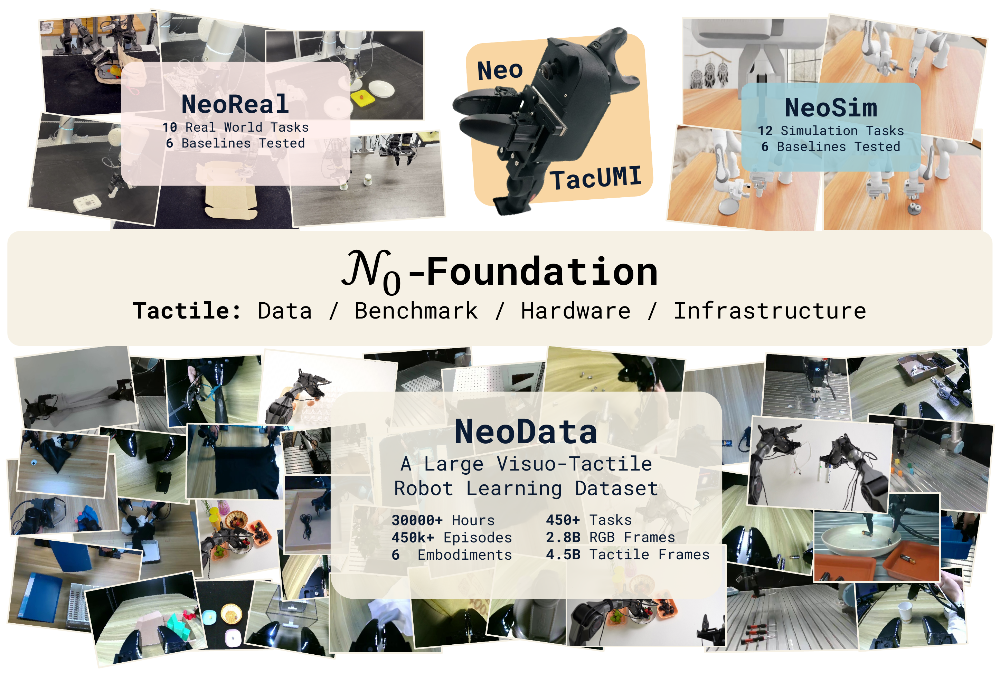

<h1 align="center">𝒩<sub>0</sub>-Foundation: A Large Scale Tactile Dataset, Benchmark and Unified Representation for Contact-rich Embodied Manipulation</h1>

<p align="center">
  <a href="#"></a>
  <a href="http://research.neoteai.com/n0-foundation"></a>
  <a href="https://huggingface.co/datasets/XinzhiEmbodied/OpenNeoData"></a>
  <a href="#"></a>
</p>

> **Note**: The arXiv and ModelScope links are placeholders and will be updated upon release.

## Overview

<p align="center">
  
</p>

Contact states, local forces, and incipient slip are rarely observable from vision alone, yet they are critical for deformable object manipulation, precise assembly, delicate force control, and sustained surface interaction. **𝒩<sub>0</sub>-Foundation** addresses this gap by treating data, representation, and evaluation as one system rather than three separate artifacts.

- **NeoData** — a large scale multimodal dataset with more than **30,000 hours** of synchronized visual and tactile demonstrations, spanning **six embodiments**, **450+ tasks**, and billions of paired RGB and tactile frames, collected through a mixture of real embodiment teleoperation and Universal Manipulation Interface (UMI) demonstrations. **OpenNeoData**, a **5,000 hour** open source subset covering six embodiments, 250+ tasks, and 200+ skills, is released for open research.
- **Unified force based tactile representation** — a sensor agnostic interface that maps tactile sensor signals to three axis surface force fields, together with **UniTF** (Unified Tactile Force), a visuo-tactile model that converts raw tactile image streams into this representation for downstream embodied policies.
- **NeoBenchmark** — standardized evaluation for contact-rich manipulation, combining the real world **NeoReal** suite (10 tasks, 6 baselines) and the simulated **NeoSim** suite (12 tasks, 6 baselines).

Experiments across both suites show that tactile feedback improves policy performance on contact-rich manipulation, that latent supervision improves the temporal structure of the learned tactile representation, and that the unified force representation is a compact and physically meaningful alternative to raw tactile images.

## Roadmap

| Stage | Contents | Status |
| :--- | :--- | :---: |
| **Pre-release** | Technical report, project page, and repository scaffolding | ✅ Available |
| **Dataset release** | OpenNeoData — 5,000 hour open source subset, with loaders and documentation | 🚧 Coming soon |
| **NeoSim release** | Simulated benchmark suite, 12 contact-rich tasks with baselines | 🚧 Coming soon |

## Citation

If you find our work useful in your research, please cite:

```bibtex
@article{n0foundation,
      title={N0-Foundation: A Large Scale Tactile Dataset, Benchmark and Unified Representation for Contact-rich Embodied Manipulation},
      author={NeoteAI},
      journal={arXiv preprint arXiv:XXXX.XXXXX},
      year={2026}
}
```
