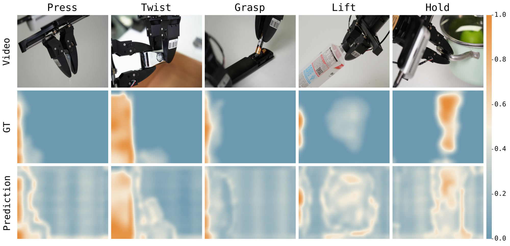

<h1 align="center">𝒩<sub>0</sub>-Foundation: Towards the Age of Tactile Intelligence</h1>

<p align="center">
  
  <a href="http://research.neoteai.com/n0-foundation"></a>
  <a href="https://huggingface.co/datasets/NeoteAIEmbodied/OpenNeoData"></a>
  
</p>

## Overview

<p align="center">
  
</p>

Contact states, local forces, and incipient slip are rarely observable from vision alone, yet they are critical for deformable object manipulation, precise assembly, delicate force control, and sustained surface interaction. **𝒩<sub>0</sub>-Foundation** (read as *Neo-Foundation*) is a tactile-centric paradigm for embodied manipulation that treats infrastructure, data, representation, and evaluation as one system rather than four separate artifacts.

- **Tactile infrastructure** — durable vision based tactile sensors, **𝒩<sub>0</sub>-TacUMI** (a sensor integrated Universal Manipulation Interface device for robot-free collection), and a synchronized visual–tactile data collection system covering both multi-embodiment teleoperation and handheld demonstrations.
- **NeoData** — a large scale multimodal dataset with more than **30,000 hours** of synchronized visual and tactile demonstrations, spanning **six embodiments**, **450 tasks**, **1.4M episodes**, **8B RGB frames**, and **10B tactile frames**, collected through a mixture of real robot teleoperation and 𝒩<sub>0</sub>-TacUMI demonstrations. **OpenNeoData**, a **5,000 hour** open source subset covering six embodiments, 250+ tasks, and 200+ skills, is released for open research.
- **NeoForce** — a unified force based tactile representation. Every tactile observation is described as a dense three axis force field over the sensing surface, giving a hardware agnostic interface, and NeoForce is the visuo-tactile model that learns transferable, temporally structured tactile features from these force fields for downstream embodied policies.
- **Standardized evaluation** — the real world **NeoReal** suite (10 tasks, 9 baselines) and the simulated **NeoSim** suite (12 tasks, 7 baselines) for contact-rich manipulation.

Experiments across both suites show that policies benefit from the physical contact state rather than from the device-specific appearance of the tactile signal, that latent supervision improves the temporal structure of the learned tactile representation, and that the unified force representation is a compact and physically meaningful alternative to raw tactile images.

## NeoForce

<p align="center">
  
</p>

Tactile hardware is fragmented: optical gel sensors, capacitive arrays, and piezoresistive skins differ in units, resolution, and sensing geometry, so a model built on any single signal format is bound to the device that produced it. 𝒩<sub>0</sub>-Foundation instead describes every tactile observation as a **dense three axis force field** over the sensing surface, `F ∈ R^(H×W×3)`, with two in-plane components that capture shear and one normal component that captures pressure. Force is physically grounded, shared across sensors, and spatially rich, so heterogeneous tactile data becomes directly comparable and jointly trainable.

**NeoForce** learns a temporally structured representation on top of these force fields. It takes synchronized chunks of RGB observations and tactile force fields, embeds both into patch tokens, and fuses them with a shared transformer backbone, so the representation encodes not only the current contact state but also the recent evolution of contact. Training combines a **reconstruction objective** in force space (force field plus contact mask) with a **latent prediction objective**, in which a teacher sees the complete input and a student predicts its latents from masked inputs, including cross-modal and patch-level targets.

<p align="center">
  
</p>

Across press, twist, grasp, lift, and hold — behaviors that differ substantially in contact geometry and duration — NeoForce recovers the contact region together with the intensity, shape, and extent of the contact patch. Latent prediction improves force estimation (MAE 0.070 → 0.066, RMSE 0.095 → 0.089) at no cost to contact localization (0.968 → 0.966 mIoU), and conditioning a policy on the NeoForce representation outperforms conditioning it on raw tactile images on NeoReal.

## Evaluation Suites

### NeoReal

<p align="center">
  
</p>

NeoReal measures policy performance under real physical interaction. It contains 10 contact-rich tasks executed on robots equipped with tactile fingers — Cardboard Box Folding, Bag Packing, Cable Winding, Board Wiping, Cup Stacking, Socket Plugging, Board Insertion, Bottle Standing, Fruit Collection, and Towel Folding — covering deformable object shaping, force-guided mating, delicate grasping, sustained surface contact, cable routing, stacking, insertion, and bimanual folding. Each task specifies a standardized initial state distribution, reset protocol, and binary success criterion, and results are reported over 20 randomized rollouts per task alongside a progressive score that credits partial milestone completion.

### NeoSim

<p align="center">
  
</p>

NeoSim provides a reproducible simulated arena for tactile-aware evaluation at scale, rendering per-contact force fields in the same three axis format as the unified representation, so that force-conditioned policies can be evaluated in simulation with the representation used for real tactile data. It contains 12 contact-rich tasks: 4 single arm tasks (Pour Ball, Unplug & Plug Charger, Plug USB, Grasp Chip) and 8 dual arm tasks (Insert Screw, Place Gears, Unstack Bowl, Cup Handover, Stack Cups, Stack Plates, Stack Bowls, Unstack Cup), reported over 100 randomized rollouts per task.

## Roadmap

| Stage | Contents | Status |
| :--- | :--- | :---: |
| **Pre-release** | Technical report, project page, and repository scaffolding | ✅ Available |
| **Dataset release** | OpenNeoData — 5,000 hour open source subset, with loaders and documentation | 🚧 Coming soon |
| **NeoForce release** | Unified force based tactile representation, with model weights and inference code | 🚧 Coming soon |
| **NeoSim release** | Simulated evaluation suite, 12 contact-rich tasks with baselines | 🚧 Coming soon |

## Citation

If you find our work useful in your research, please cite:

```bibtex
@article{n0foundation,
      title={N0-Foundation: Towards the Age of Tactile Intelligence},
      author={NeoteAI Team and TEAI Team},
      journal={arXiv preprint arXiv:XXXX.XXXXX},
      year={2026}
}
```
